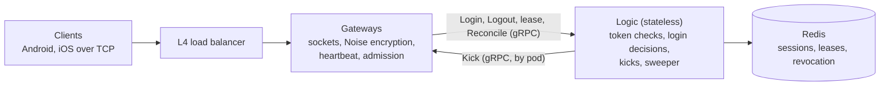

# goim

*English | [中文](#中文)*

The connection and session layer of a WeChat-style instant-messaging backend, written in Go and designed for **1M concurrent mobile users**.

Gateways hold long-lived, encrypted TCP connections. A stateless Logic tier checks tokens, decides which login wins, and keeps the session state in Redis. The design goal is correctness under races and failures, without distributed locks: a late or out-of-order event must never kick out or erase a newer session.

## Measured results

From the recorded Tier 2 benchmark runs (24-core host, all processes on one machine; one gateway gets 6 cores / 12 threads):

| What | Result |
| --- | --- |
| Connections on one gateway | **600,000**, all logged in within 121 s at 5,000/s, none lost while held |
| Login latency at 600k | p99 20 ms (max 64 ms); heartbeat round trip p99 2 ms |
| Gateway CPU at 600k | 1.7 cores while logging in 5,000/s; 0.17 cores holding 600k at a 150 s heartbeat (44 µs per Pong); 0.20 cores with Reconcile checking 4,300 connections/s (a 2-minute cycle; the default 10-minute cycle needs ~1,100/s) |
| Gateway memory at 600k | ~1.2 KB of live heap per connection, 1.25 GB RSS; Go's default GC ran once per 150 s (0.24 ms pause) |
| Heartbeat cost at 200k | 0.08 cores at a 150 s heartbeat, 0.15 cores at 60 s |
| Four gateways | 100,000 connections: login p99 24 ms, heartbeat round trip p99 4 ms |
| A 200k gateway SIGKILLed | all 200,000 SDK clients back online on the survivor, p99 22.7 s from the kill (SLO: 30 s); the survivor (400k) missed no lease renewal; one Kick per relogin, none retried once the process was gone; the dead epoch swept 82 s after the kill |
| A 200k gateway silently lost (iptables DROP on its ports, then SIGKILL; 30 s heartbeat) | all 200,000 SDK clients detected the loss by Pong timeout (no FIN or RST got through; detection p50 23.3 s, p99 39.7 s, max 40.0 s: one heartbeat plus the 10 s Pong timeout), and were back on the survivor within p99 20.7 s of detecting it (SLO: 30 s); the survivor's Login p99 stayed in the same 32 ms bucket as in the ramp while Kicks to the silent gateway timed out or failed fast (132k sent, 68.5k dropped by the full queue, none refused, none given up as live); Logic's goroutines 25 → 93; the survivor missed no lease renewal; the dead epoch swept 80 s after the kill |
| Logic slowed to a 25% CPU quota (one process) | measured login throughput 3,503/s on fresh logins (2,696–3,710 over five runs, varying with the CPU clock) and 2,717/s in a kill storm of relogins that each Kick the dead gateway; with each gateway's Login-queue cap at 2 × that throughput (the spec's rule with a 3 s margin), a 105k-client storm onto one survivor was answered 160,504 times with `Busy` and never `EXPIRED` (login p99 3.10 s, max 3.66 s against the 5 s deadline); all clients back in 51 s (p99 35.8 s from the kill; no SLO gate at 30 × throughput); no lease renewal missed while Logic was throttled in 78% of 100 ms periods. At 4 × throughput (a 1 s margin) 2.7–19.6% came back `EXPIRED` in four of five runs: in the storm Logic ran at 0.69–1.04 of the calibrated throughput, with few-second dips below that |
| Floods (runs 30c, 30d) | **Handshake storm:** 200,000 clients at 20,000/s onto one gateway all logged in (p99 4.5 s) and the 25,000/s handshake bucket refused none; the concurrency limit (6 handshake slots) turned 27% of handshakes away for a retry, and the load generator, saturated on its 8 cores, reached 15,962 new clients/s. **Garbage handshakes:** 80,000/s for 90 s (7.2M, each costing the gateway a DH) beside 400,000 clients Pinging every 30 s: every Ping answered (Pong p99 4 ms, none missing), no lease renewal missed; each gateway's 3 slots, not its bucket, bound the flood at ~21,600 DH/s. **Slow clients:** 80,000 slow-handshake and 40,000 slow-auth connections, each closed by the gateway's 5 s timeouts (held p99 6.2 s, max 6.6 s) and redialed, while 400,000 legitimate clients logged in at 5,000/s: all online, none refused for memory or capacity, no `Busy` (login p99 56 ms; 27% of their handshakes refused by the concurrency limit and retried), every Ping answered (Pong p99 18 ms). At 10,000/s the load generator's retries saturated it (run 30c). The slow floods ran on the gateways' and Logic's CPUs, not the load generator's |
| A 600k gateway SIGKILLed | all 600,000 SDK clients back on two empty survivors in 179 s (from the kill p50 39 s, p99 98 s; no SLO at this size), with no swap; the survivors' handshake limiter turned ~3.9M handshake attempts away and never refused one at capacity; no lease renewal missed; the dead epoch swept 120 s after the kill. These times are an upper bound: on one host the load generator's 600k SDK clients used 12 of its 14 cores in the storm's first 30 s |
| Race test suite | 58 fault-injection scenarios against real processes and a real redis-server, plus mutation checks |
| Tests | 483 Go tests, about half of the ~32k lines of Go |

## Architecture



One firm rule: **gateways never touch Redis; only Logic does.** The gateway is the source of truth for what is connected. Redis holds a copy that Logic keeps in line with the gateways.

## Key design points

- **Event-driven gateway.** Built on [gnet](https://github.com/panjf2000/gnet), with a Noise NK handshake (the server key is built into the app, so no certificates), ChaCha20-Poly1305 framing, timing-wheel heartbeats, admission control and a graceful drain on deploy.
- **One atomic decision per login.** All of a user's sessions live in one Redis slot, so a single Lua script compares the new login with the stored one and decides who wins. It uses per-device connection sequence numbers and a 5 s login deadline. Multi-device rules are per slot (app × platform), and kick reasons are designed so two devices can never kick each other forever.
- **Logouts that can't erase the wrong session.** A Logout deletes a record only if it still names this exact connection (gateway, epoch, conn_id). A logout fence holds it back until no earlier write for that connection can still land.
- **Gateway failure recovery.** Gateways renew a lease every 10 s (30 s TTL), and a session only counts while its gateway's lease exists. A distributed sweeper deletes a dead epoch's sessions. A guard keeps it from mass-deleting while Redis or Logic itself is unhealthy, and a wrongly swept gateway restores its sessions on its next renewal.
- **Reconcile.** Every gateway periodically reports the connections it really holds, and Logic repairs Redis with compare-and-set writes. Lost Logouts, lost Kicks and failover write loss are all fixed within one cycle.
- **Revocation.** Revocation markers ("tokens issued before T are invalid") are written and confirmed on a replica before any Kick is sent, so a lost Kick can't bring a revoked session back.
- **Client SDK.** Deterministic reconnect rules: a random 0–20 s spread after a drop, then exponential backoff. A dead gateway's users come back as a bounded storm, not a stampede.

The full reasoning, including the rejected alternatives, is in the [design guide](docs/guides/connection-session-core-guide.md) and the [design spec](docs/superpowers/specs/2026-10-03-connection-session-core-design-rev6.md).

## Repository layout

| Path | Contents |
| --- | --- |
| `cmd/gateway`, `cmd/logic` | The two server binaries |
| `cmd/loadgen` | Load generator: light (raw connections) and SDK modes, garbage-handshake and slow-client flood modes, several instances per stack, histograms exact to 1 ms, kill/mark control API |
| `cmd/devtoken` | Development token issuer (JWKS) |
| `internal/gateway`, `internal/logic` | Gateway and Logic |
| `internal/store` | Redis session store: Lua scripts for login, logout, lease, sweep, reconcile, revoke |
| `internal/sdk`, `internal/clientconn` | Client SDK and the low-level client connection |
| `internal/racetest`, `internal/fault` | Race scenarios and fault injection |
| `api/` | Protobuf definitions (client protocol and internal gRPC) |
| `scripts/` | Local stack, load probe and Tier 2 benchmark scenarios |
| `docs/` | Design spec, guide, implementation plans and review records |

## Running the tests

Needs Go 1.27. The race suite and load probe also need `redis-server`; `make redis-server` builds a pinned 7.4.11 locally, no Docker needed.

```sh
make test              # unit and Lua tests on in-process miniredis, race detector on
make test-race-suite   # 58 race scenarios on real processes and redis-server
make test-load-probe   # 2-gateway stack, 3k connections, then a killed gateway (~1 min)
```

Tier 2 benchmark scenarios (`smoke`, `race`, `foundation`, …) run on a dedicated host:

```sh
GOIM_TEST_TIER=2 make test-tier2 SCENARIO=smoke
```

## Status

This is sub-project 1 (connection and session core) of a larger IM system. Done: gateway, Logic, session store, TCP transport, client SDK, race suite, load generator, the Tier 2 benchmark foundation, the single-gateway capacity and heartbeat-cost benchmarks (600k connections), gateway loss with SDK clients at 200k and 600k, silent loss of a 200k gateway, a slowed Logic (a CPU quota), and handshake and slow-client floods. Next: Redis Cluster failover, and Kubernetes rolling restarts. Messaging, push and the WebSocket transport are later sub-projects.

## License

Licensed under the GNU Affero General Public License v3.0 (AGPL-3.0-only); see [LICENSE](LICENSE). If you run a modified version as a network service, you must offer its source to the service's users.

---

## 中文

*[English](#goim) | 中文*

一个类微信即时通讯后端的连接与会话层，用 Go 编写，按 **100 万移动端同时在线** 设计。

网关持有长连接、加密的 TCP 连接。无状态的 Logic 层负责校验 token、裁决哪次登录胜出，并把会话状态存放在 Redis 中。设计目标是在竞态和故障下保持正确，且不使用分布式锁：迟到或乱序的事件绝不能踢掉或抹除一个更新的会话。

### 实测结果

来自已记录的 Tier 2 压测（24 核主机，所有进程在同一台机器上；单个网关分配 6 核 / 12 线程）：

| 项目 | 结果 |
| --- | --- |
| 单网关连接数 | **60 万**，以 5,000/s 在 121 s 内全部登录，保持期间无一断开 |
| 60 万时的登录延迟 | p99 20 ms（最大 64 ms）；心跳往返 p99 2 ms |
| 60 万时的网关 CPU | 以 5,000/s 登录时 1.7 核；150 s 心跳下保持 60 万连接 0.17 核（每次 Pong 44 µs）；Reconcile 以每秒 4,300 个连接对账时 0.20 核（2 分钟周期；默认 10 分钟周期约需 1,100/s） |
| 60 万时的网关内存 | 每连接约 1.2 KB 存活堆内存，RSS 1.25 GB；Go 默认 GC 每 150 s 运行一次（暂停 0.24 ms） |
| 20 万连接的心跳开销 | 150 s 心跳 0.08 核，60 s 心跳 0.15 核 |
| 四个网关 | 10 万连接：登录 p99 24 ms，心跳往返 p99 4 ms |
| SIGKILL 一个 20 万连接的网关 | 20 万个 SDK 客户端全部在存活网关上重新上线，从 kill 起 p99 22.7 s（SLO：30 s）；存活网关（40 万连接）没有错过任何一次租约续期；每次重新登录一次 Kick，进程消失后不再重试；死亡 epoch 在 kill 后 82 s 清扫完毕 |
| 静默丢失一个 20 万连接的网关（iptables DROP 其端口后 SIGKILL；30 s 心跳） | 20 万个 SDK 客户端全部通过 Pong 超时发现故障（没有 FIN 或 RST 漏过；发现时间 p50 23.3 s、p99 39.7 s、最大 40.0 s：一个心跳周期加 10 s Pong 超时），从发现起 p99 20.7 s 内在存活网关上重新上线（SLO：30 s）；发往静默网关的 Kick 超时或快速失败（发出 13.2 万次，队列满丢弃 6.85 万次，无拒绝，无以存活租约放弃），存活网关的 Login p99 仍与爬坡阶段同在 32 ms 桶内；Logic 的 goroutine 数 25 → 93；存活网关没有错过任何一次租约续期；死亡 epoch 在 kill 后 80 s 清扫完毕 |
| Logic 限制在 25% CPU 配额（单进程） | 新登录实测吞吐 3,503/s（五次运行 2,696–3,710，随 CPU 频率变化），在重新登录风暴中（每次登录都要向死亡网关发 Kick）为 2,717/s；每个网关的 Login 队列上限设为该吞吐的 2 倍（3 s 余量，规格的 1 s 余量正在排查）时，10.5 万客户端涌向一个存活网关，被回复 `Busy` 160,504 次，没有一次 `EXPIRED`（登录 p99 3.10 s，最大 3.66 s，期限 5 s）；全部客户端 51 s 内重新上线（从 kill 起 p99 35.8 s；30 倍吞吐的规模不设 SLO 门限）；Logic 在 78% 的 100 ms 周期被限流，仍没有错过任何一次租约续期。上限为 4 倍吞吐（规格的 1 s 余量）时 3.5% 返回 `EXPIRED`：正在排查 |
| 洪泛（运行 30c、30d） | **握手风暴：** 20 万客户端以 20,000/s 涌向一个网关，全部登录（p99 4.5 s），25,000/s 的握手令牌桶没有拒绝一次；并发上限（6 个握手槽位）拒绝了 27% 的握手让客户端重试，压测工具在其 8 核上饱和，新客户端达到 15,962/s。**垃圾握手：** 80,000/s 持续 90 s（720 万次，每次让网关做一次 DH），旁边 40 万客户端每 30 s Ping 一次：每个 Ping 都有应答（Pong p99 4 ms，无一缺失），没有错过任何一次租约续期；限住洪泛的是每个网关的 3 个槽位而不是令牌桶，约 21,600 次 DH/s。**慢客户端：** 8 万个慢握手和 4 万个慢认证连接，各自被网关的 5 s 超时关闭（保持 p99 6.2 s，最大 6.6 s）后重新拨号，同时 40 万合法客户端以 5,000/s 登录：全部上线，没有因内存或容量被拒绝，没有 `Busy`（登录 p99 56 ms；其 27% 的握手被并发上限拒绝后重试），每个 Ping 都有应答（Pong p99 18 ms）。在 10,000/s 时压测工具被重试压满（运行 30c）。慢洪泛运行在网关和 Logic 的 CPU 上，而不是压测工具的 |
| SIGKILL 一个 60 万连接的网关 | 60 万个 SDK 客户端全部在两个空的存活网关上重新上线，用时 179 s（从 kill 起 p50 39 s、p99 98 s；此规模不设 SLO），无 swap；存活网关的握手限流拒绝了约 390 万次握手尝试，从未因容量满而拒绝；没有错过任何一次租约续期；死亡 epoch 在 kill 后 120 s 清扫完毕。这些时间是上界：在单台主机上，压测工具的 60 万个 SDK 客户端在风暴的前 30 s 用掉了其 14 核中的 12 核 |
| 竞态测试集 | 58 个故障注入场景，运行在真实进程和真实 redis-server 上，并带变异测试 |
| 测试 | 483 个 Go 测试，约占 3.2 万行 Go 代码的一半 |

### 架构


一条硬规则：**网关从不访问 Redis，只有 Logic 访问。** 网关是“谁在线”的事实来源；Redis 中是一份副本，由 Logic 负责与网关保持一致。

### 关键设计

- **事件驱动的网关。** 基于 [gnet](https://github.com/panjf2000/gnet)，使用 Noise NK 握手（服务端公钥内置在 App 中，无需证书）、ChaCha20-Poly1305 加密分帧、时间轮心跳、准入控制，以及发布时的优雅排空（drain）。
- **每次登录一次原子裁决。** 一个用户的所有会话都在同一个 Redis slot 中，因此一个 Lua 脚本就能比较新登录与已存会话并决定谁胜出。它依据每设备的连接序号（conn_seq）和 5 秒登录截止时间。多端规则按 slot（App × 平台类型）划分；踢线原因经过设计，两台设备不会无休止地互踢。
- **不会误删的登出。** 只有当记录仍指向这条连接本身（gateway、epoch、conn_id）时，登出才会删除它。登出栅栏（logout fence）会把登出延后，直到这条连接之前的写入都不可能再落地。
- **网关故障恢复。** 网关每 10 秒续约一次（TTL 30 秒），会话只在其网关租约存在时有效。分布式清扫器删除已死 epoch 的会话；保护机制确保在 Redis 或 Logic 自身不健康时不会批量误删；被误清扫的健康网关会在下一次续约时恢复其会话。
- **Reconcile（对账）。** 每个网关定期上报它真实持有的连接，Logic 用 compare-and-set 写入修复 Redis。丢失的登出、丢失的踢线以及主从切换丢失的写入，都会在一个周期内被修正。
- **吊销。** 吊销标记（“T 之前签发的 token 无效”）在发送任何踢线之前先写入并在副本上确认，因此即使踢线丢失，被吊销的会话也不会被恢复。
- **客户端 SDK。** 确定性的重连规则：断线后在 0–20 秒内随机分散，然后指数退避。一个网关宕机后，其用户以有界的重连风暴回来，而不是一拥而上。

完整的设计理由（包括被否决的方案）见 [设计指南](docs/guides/connection-session-core-guide.zh-CN.md)和 [设计文档](docs/superpowers/specs/2026-10-03-connection-session-core-design-rev6.zh-CN.md)。

### 目录结构

| 路径 | 内容 |
| --- | --- |
| `cmd/gateway`、`cmd/logic` | 两个服务端程序 |
| `cmd/loadgen` | 压测工具：light（裸连接）和 SDK 两种模式，垃圾握手和慢客户端洪泛模式，同一栈上可运行多个实例，精确到 1 ms 的直方图，kill/mark 控制接口 |
| `cmd/devtoken` | 开发用 token 签发服务（JWKS） |
| `internal/gateway`、`internal/logic` | 网关与 Logic |
| `internal/store` | Redis 会话存储：登录、登出、租约、清扫、对账、吊销的 Lua 脚本 |
| `internal/sdk`、`internal/clientconn` | 客户端 SDK 与底层客户端连接 |
| `internal/racetest`、`internal/fault` | 竞态场景与故障注入 |
| `api/` | Protobuf 定义（客户端协议与内部 gRPC） |
| `scripts/` | 本地集群、压测探针与 Tier 2 压测场景 |
| `docs/` | 设计文档、指南、实施计划与评审记录 |

### 运行测试

需要 Go 1.27。竞态测试集和压测探针还需要 `redis-server`；`make redis-server` 会在本地编译固定版本 7.4.11，无需 Docker。

```sh
make test              # 单元测试和 Lua 测试，跑在进程内 miniredis 上，开启 race 检测
make test-race-suite   # 58 个竞态场景，跑在真实进程和 redis-server 上
make test-load-probe   # 2 个网关、3k 连接，然后杀掉一个网关（约 1 分钟）
```

Tier 2 压测场景（`smoke`、`race`、`foundation` 等）在专用主机上运行：

```sh
GOIM_TEST_TIER=2 make test-tier2 SCENARIO=smoke
```

### 当前状态

这是一个更大 IM 系统中的子项目 1（连接与会话核心）。已完成：网关、Logic、会话存储、TCP 传输、客户端 SDK、竞态测试集、压测工具、Tier 2 压测基础设施，单网关容量和心跳开销压测（60 万连接），使用 SDK 客户端的 20 万和 60 万连接网关故障，静默丢失一个 20 万连接的网关，变慢的 Logic（CPU 配额），以及握手洪泛和慢客户端洪泛。下一步：Redis Cluster 故障转移，以及 Kubernetes 滚动重启。消息、推送和 WebSocket 传输属于后续子项目。

### 许可证

本项目采用 GNU Affero 通用公共许可证 v3.0（AGPL-3.0-only），见 [LICENSE](LICENSE)。如果你以网络服务的形式运行修改后的版本，必须向该服务的用户提供其源代码。

[回到 English](#goim)
