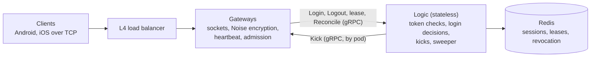

# goim

*English | [中文](README.zh-CN.md)*

The connection and session layer of a WeChat-style instant-messaging backend, written in Go and designed for **1M concurrent mobile users**.

Gateways hold long-lived, encrypted TCP connections. A stateless Logic tier checks tokens, decides which login wins, and keeps the session state in Redis. The design goal is correctness under races and failures, without distributed locks: a late or out-of-order event must never kick out or erase a newer session.

## Measured results

From the recorded Tier 2 benchmark runs (24-core host, all processes on one machine):

| What | Result |
| --- | --- |
| Concurrent connections | 100,000 across 4 gateways (25k each), ramped at 5,000/s |
| Login latency | p99 24 ms (max 52 ms) |
| Heartbeat round trip | p99 11 ms, 718k Pongs, none missing |
| Gateway memory | ~3.5 KB per connection |
| Recovery after a gateway is killed | every user back online, p99 19.9 s (SLO: 30 s) |
| Race test suite | 58 fault-injection scenarios against real processes and a real redis-server, plus mutation checks |
| Tests | 435 Go tests, about half of the ~30k lines of Go |

## Architecture



One firm rule: **gateways never touch Redis; only Logic does.** The gateway is the source of truth for what is connected. Redis holds a copy that Logic keeps in line with the gateways.

## Key design points

- **Event-driven gateway.** Built on [gnet](https://github.com/panjf2000/gnet), with a Noise NK handshake (the server key is built into the app, so no certificates), ChaCha20-Poly1305 framing, timing-wheel heartbeats, admission control and a graceful drain on deploy.
- **One atomic decision per login.** All of a user's sessions live in one Redis slot, so a single Lua script compares the new login with the stored one and decides who wins. It uses per-device connection sequence numbers and a 5 s login deadline. Multi-device rules are per slot (app × platform), and kick reasons are designed so two devices can never kick each other forever.
- **Logouts that can't erase the wrong session.** A Logout deletes a record only if it still names this exact connection (gateway, epoch, conn_id). A logout fence holds it back until no earlier write for that connection can still land.
- **Gateway failure recovery.** Gateways renew a lease every 10 s (30 s TTL), and a session only counts while its gateway's lease exists. A distributed sweeper deletes a dead epoch's sessions. A guard keeps it from mass-deleting while Redis or Logic itself is unhealthy, and a wrongly swept gateway restores its sessions on its next renewal.
- **Reconcile.** Every gateway periodically reports the connections it really holds, and Logic repairs Redis with compare-and-set writes. Lost Logouts, lost Kicks and failover write loss are all fixed within one cycle.
- **Revocation.** Revocation markers ("tokens issued before T are invalid") are written and confirmed on a replica before any Kick is sent, so a lost Kick can't bring a revoked session back.
- **Client SDK.** Deterministic reconnect rules: a random 0–20 s spread after a drop, then exponential backoff. A dead gateway's users come back as a bounded storm, not a stampede.

The full reasoning, including the rejected alternatives, is in the [design guide](docs/guides/connection-session-core-guide.md) ([中文](docs/guides/connection-session-core-guide.zh-CN.md)) and the [design spec](docs/superpowers/specs/2026-10-03-connection-session-core-design-rev6.md).

## Repository layout

| Path | Contents |
| --- | --- |
| `cmd/gateway`, `cmd/logic` | The two server binaries |
| `cmd/loadgen` | Load generator: light (raw connections) and SDK modes, histograms exact to 1 ms, kill/mark control API |
| `cmd/devtoken` | Development token issuer (JWKS) |
| `internal/gateway`, `internal/logic` | Gateway and Logic |
| `internal/store` | Redis session store: Lua scripts for login, logout, lease, sweep, reconcile, revoke |
| `internal/sdk`, `internal/clientconn` | Client SDK and the low-level client connection |
| `internal/racetest`, `internal/fault` | Race scenarios and fault injection |
| `api/` | Protobuf definitions (client protocol and internal gRPC) |
| `scripts/` | Local stack, load probe and Tier 2 benchmark scenarios |
| `docs/` | Design spec, guide, implementation plans and review records |

## Running the tests

Needs Go 1.27. The race suite and load probe also need `redis-server`; `make redis-server` builds a pinned 7.4.11 locally, no Docker needed.

```sh
make test              # unit and Lua tests on in-process miniredis, race detector on
make test-race-suite   # 58 race scenarios on real processes and redis-server
make test-load-probe   # 2-gateway stack, 3k connections, then a killed gateway (~1 min)
```

Tier 2 benchmark scenarios (`smoke`, `race`, `foundation`, …) run on a dedicated host:

```sh
GOIM_TEST_TIER=2 make test-tier2 SCENARIO=smoke
```

## Status

This is sub-project 1 (connection and session core) of a larger IM system. Done: gateway, Logic, session store, TCP transport, client SDK, race suite, load generator and the Tier 2 benchmark foundation. Next: the full Tier 2 load scenarios (600k connections on one gateway, reconnect storms, floods). Messaging, push and the WebSocket transport are later sub-projects.
