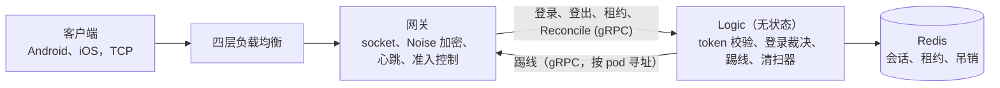

# goim

*[English](README.md) | 中文*

一个类微信即时通讯后端的连接与会话层，用 Go 编写，按 **100 万移动端同时在线** 设计。

网关持有长连接、加密的 TCP 连接。无状态的 Logic 层负责校验 token、裁决哪次登录胜出，并把会话状态存放在 Redis 中。设计目标是在竞态和故障下保持正确，且不使用分布式锁：迟到或乱序的事件绝不能踢掉或抹除一个更新的会话。

## 实测结果

来自已记录的 Tier 2 压测（24 核主机，所有进程在同一台机器上）：

| 项目 | 结果 |
| --- | --- |
| 并发连接 | 4 个网关共 100,000 连接（每个 25k），以 5,000/s 爬坡 |
| 登录延迟 | p99 24 ms（最大 52 ms） |
| 心跳往返 | p99 11 ms，71.8 万次 Pong，无一丢失 |
| 网关内存 | 每连接约 3.5 KB |
| 杀掉一个网关后的恢复 | 所有用户重新上线，p99 19.9 s（SLO：30 s） |
| 竞态测试集 | 58 个故障注入场景，运行在真实进程和真实 redis-server 上，并带变异测试 |
| 测试 | 435 个 Go 测试，约占 3 万行 Go 代码的一半 |

## 架构



一条硬规则：**网关从不访问 Redis，只有 Logic 访问。** 网关是“谁在线”的事实来源；Redis 中是一份副本，由 Logic 负责与网关保持一致。

## 关键设计

- **事件驱动的网关。** 基于 [gnet](https://github.com/panjf2000/gnet)，使用 Noise NK 握手（服务端公钥内置在 App 中，无需证书）、ChaCha20-Poly1305 加密分帧、时间轮心跳、准入控制，以及发布时的优雅排空（drain）。
- **每次登录一次原子裁决。** 一个用户的所有会话都在同一个 Redis slot 中，因此一个 Lua 脚本就能比较新登录与已存会话并决定谁胜出。它依据每设备的连接序号（conn_seq）和 5 秒登录截止时间。多端规则按 slot（App × 平台类型）划分；踢线原因经过设计，两台设备不会无休止地互踢。
- **不会误删的登出。** 只有当记录仍指向这条连接本身（gateway、epoch、conn_id）时，登出才会删除它。登出栅栏（logout fence）会把登出延后，直到这条连接之前的写入都不可能再落地。
- **网关故障恢复。** 网关每 10 秒续约一次（TTL 30 秒），会话只在其网关租约存在时有效。分布式清扫器删除已死 epoch 的会话；保护机制确保在 Redis 或 Logic 自身不健康时不会批量误删；被误清扫的健康网关会在下一次续约时恢复其会话。
- **Reconcile（对账）。** 每个网关定期上报它真实持有的连接，Logic 用 compare-and-set 写入修复 Redis。丢失的登出、丢失的踢线以及主从切换丢失的写入，都会在一个周期内被修正。
- **吊销。** 吊销标记（“T 之前签发的 token 无效”）在发送任何踢线之前先写入并在副本上确认，因此即使踢线丢失，被吊销的会话也不会被恢复。
- **客户端 SDK。** 确定性的重连规则：断线后在 0–20 秒内随机分散，然后指数退避。一个网关宕机后，其用户以有界的重连风暴回来，而不是一拥而上。

完整的设计理由（包括被否决的方案）见 [设计指南](docs/guides/connection-session-core-guide.zh-CN.md)和 [设计文档](docs/superpowers/specs/2026-10-03-connection-session-core-design-rev6.zh-CN.md)。

## 目录结构

| 路径 | 内容 |
| --- | --- |
| `cmd/gateway`、`cmd/logic` | 两个服务端程序 |
| `cmd/loadgen` | 压测工具：light（裸连接）和 SDK 两种模式，精确到 1 ms 的直方图，kill/mark 控制接口 |
| `cmd/devtoken` | 开发用 token 签发服务（JWKS） |
| `internal/gateway`、`internal/logic` | 网关与 Logic |
| `internal/store` | Redis 会话存储：登录、登出、租约、清扫、对账、吊销的 Lua 脚本 |
| `internal/sdk`、`internal/clientconn` | 客户端 SDK 与底层客户端连接 |
| `internal/racetest`、`internal/fault` | 竞态场景与故障注入 |
| `api/` | Protobuf 定义（客户端协议与内部 gRPC） |
| `scripts/` | 本地集群、压测探针与 Tier 2 压测场景 |
| `docs/` | 设计文档、指南、实施计划与评审记录 |

## 运行测试

需要 Go 1.27。竞态测试集和压测探针还需要 `redis-server`；`make redis-server` 会在本地编译固定版本 7.4.11，无需 Docker。

```sh
make test              # 单元测试和 Lua 测试，跑在进程内 miniredis 上，开启 race 检测
make test-race-suite   # 58 个竞态场景，跑在真实进程和 redis-server 上
make test-load-probe   # 2 个网关、3k 连接，然后杀掉一个网关（约 1 分钟）
```

Tier 2 压测场景（`smoke`、`race`、`foundation` 等）在专用主机上运行：

```sh
GOIM_TEST_TIER=2 make test-tier2 SCENARIO=smoke
```

## 当前状态

这是一个更大 IM 系统中的子项目 1（连接与会话核心）。已完成：网关、Logic、会话存储、TCP 传输、客户端 SDK、竞态测试集、压测工具和 Tier 2 压测基础设施。下一步：完整的 Tier 2 压测场景（单网关 60 万连接、重连风暴、洪泛）。消息、推送和 WebSocket 传输属于后续子项目。
