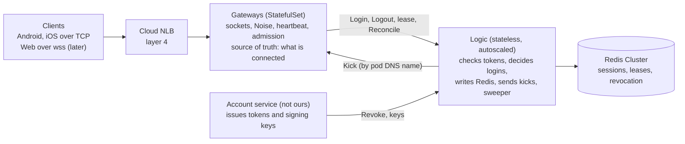

# Connection & Session Core — Reader's Guide (spec rev4)

*As of 2026-10-04. Plain-language companion to [the rev4 spec](../superpowers/specs/2026-10-03-connection-session-core-design-rev4.md). When the two disagree, the spec wins. 中文版: [connection-session-core-guide.zh-CN.md](connection-session-core-guide.zh-CN.md).*

## What this is

Sub-project 1 keeps track of **who is online and on which server**, for a WeChat-like IM serving about 1M concurrent users. It covers connect, encrypted handshake, login, heartbeat, kick, revoke and disconnect. Messaging, push and feeds come in later sub-projects.

**The three goals**

| Goal | Target |
| --- | --- |
| Capacity | One gateway server can hold 600k connections (a benchmark). In production we run each at no more than 200k, so losing one hurts less. |
| Recovery | If one gateway dies, 99% of its users are logged in again within 30s. |
| Correctness | A late or out-of-order event never kicks out or erases a newer session. Automated tests check every race we know of. |

For 1M users we run at least 6 gateways: 5 carry the load and 1 is spare, so any single one can die.

## The big picture

There are three server roles, and one firm rule: **gateways never touch Redis; only Logic does.**

| Component | What it does | Holds state? |
| --- | --- | --- |
| Client (Android, iOS; web later) | Keeps one long-lived encrypted connection; reconnects by fixed rules | Its device_id and a connection counter |
| Cloud NLB (layer 4) | Spreads TCP connections across gateways | No |
| Gateway (Kubernetes StatefulSet, one Go process per pod, built on gnet) | Holds the sockets; does encryption, framing, heartbeats and admission control | **Yes: the live connections. It is the source of truth for what is connected.** |
| Logic (stateless Deployment, autoscaled) | Checks tokens, decides who wins a login, writes Redis, sends kicks | No |
| Redis Cluster | Stores "user X is online on gateway G, connection C" | A copy that Logic keeps in line with the gateways |
| Account service (outside this project) | Issues login tokens; asks Logic to revoke sessions | Not ours |

Gateways and Logic talk over gRPC in both directions. Gateways send logins, logouts, lease renewals and reconciliation reports to Logic. Logic sends kicks straight to a specific gateway pod by its DNS name.

## Six words to know first

The rest of the design is built from these.

| Word | Meaning | Example |
| --- | --- | --- |
| **Slot** | One allowed session per user, app and platform type. A new login on the same slot replaces the old one. | Alice on mobile and Alice on PC are two slots and can both be online. Alice on two phones share one slot, so the second phone kicks out the first. |
| **Epoch** | A random number a gateway picks each time it starts. It tells two lives of the same pod apart. | `gw-17` crashes and restarts: the old and new process have different epochs, so leftovers from the old one can't be confused with the new one. |
| **conn_id** | A connection's ID, unique and never reused within an epoch. | A logout for connection 42 can only ever delete connection 42's record. |
| **device_id + conn_seq** | Identity of one app install, plus a counter it bumps on every connection attempt. | A phone that reconnects sends conn_seq 8 after 7, so its newer connection wins. |
| **Lease** | A Redis key that each gateway renews every 10s; it expires after 30s. | Lease present = gateway alive. A session record only counts if its gateway's lease exists. |
| **Reconcile** | A periodic check (about every 10 min) where a gateway sends Logic the list of connections it really holds, and Logic fixes Redis to match. | A lost logout left a stale "online" record; the next Reconcile deletes it. |

In Redis, a session is stored as `sess:{uid}` → one field per slot, holding `gateway | epoch | conn_id | device_id | conn_seq | login time | token issue time`.

## Life of a connection

A connection moves through four states: **HANDSHAKE → AUTH_PENDING → ONLINE → CLOSED**.

1. **Connect.** The phone opens TCP to the NLB, which picks a gateway. If that gateway is full (250k sockets), it closes the socket at once and the phone retries in 1–3s, probably landing on another gateway.
2. **Handshake (HANDSHAKE, 5s limit).** Phone and gateway run a Noise NK handshake. The server's public key is built into the app, so no certificates are involved. After this every frame is encrypted with ChaCha20-Poly1305.
3. **Login (AUTH_PENDING, 5s limit to send it).** The phone sends its token, app, platform, device_id and conn_seq. The gateway stamps the arrival time (`recv_ms`) and forwards it to Logic in a batch.
4. **Logic decides.** It checks the token's signature locally (no database call), then runs one atomic Redis script that either writes the session or rejects it (see the next section). If an older connection lost its slot, Logic sends a **Kick** to that connection's gateway.
5. **Online (ONLINE).** The server tells the phone to ping every 150s. Any frame counts as a sign of life. After 310s of silence the gateway treats the connection as dead.
6. **Close (CLOSED).** The gateway sends a **Logout** to Logic, which deletes the Redis record only if it still points at this exact connection.

**Kick reasons the user may see.** None of them makes the app reconnect by itself, which prevents two devices from kicking each other forever.

| Reason | When | App does |
| --- | --- | --- |
| `REPLACED` | Same device, newer connection | Goes quiet; reconnects when the user returns |
| `KICKED_BY_OTHER_DEVICE` | Another device took the slot | Tells the user |
| `REVOKED` | Ban, password change, "log out everywhere", or "log this device out" | Drops the token; shows the login screen |

**Login tokens** are short-lived (about 1h) and checked only at login. An already-online connection is not cut off when its token expires; revocation handles security for long-lived connections.

**Revocation markers.** Revoking writes a marker in Redis (`rev:{uid}`): "tokens issued before time T are no good". It can cover the whole user or just one slot, for example "log this device out". The marker is written and confirmed on a Redis replica *before* the session is deleted or the Kick is sent. So even if the Kick is lost, the next Reconcile sees the marker and closes the connection instead of bringing the session back. When the app itself logs out, no marker is needed: the gateway closes that connection, so nothing can bring it back.

## Staying correct under races

The classic bug: a user's old connection drops, they reconnect elsewhere, and the *late* disconnect from the old connection erases their *new* session. Four simple tools prevent this and its relatives; no distributed lock is needed.

**1. Delete only what you own.** A Logout deletes the Redis record only if it still says `gateway | epoch | conn_id` of *this* connection. Because conn_ids are never reused, a late Logout from an old connection finds someone else's record and does nothing.

**2. One atomic script decides every login.** All of a user's data lives in one Redis slot, so a single Lua script can read and write it atomically. It compares the new login with the stored one:

| Stored session vs new login | Result |
| --- | --- |
| Nothing stored | Write it |
| Same phone, higher conn_seq | New one wins; kick the old (`REPLACED`) |
| Same phone, same or lower conn_seq, within 5s | Reject as `STALE`: this is a delayed, older attempt. The reply tells the phone the stored counter so it can catch up. |
| Same phone, lower conn_seq, more than 5s later | Accept: the counter went backwards (app reinstall, backup restore) |
| Different phone, arrived later | New one wins; kick the old (`KICKED_BY_OTHER_DEVICE`) |
| Different phone, arrived earlier | Reject as `SUPERSEDED`: a newer device already won |

**3. A 5s login deadline.** The script refuses any login that reaches Redis more than 5s (`login_deadline`) after the gateway received it (`EXPIRED`). So after `recv_ms + 5s`, we know for sure that a login can no longer write anything, even if its reply was lost.

**4. The Logout fence.** The gateway holds back a connection's Logout until no earlier write for that connection can still land:

- its Login has a definite answer, **or** 6s (the deadline + 1s for clock skew) have passed since the gateway received it; **and**
- no Reconcile report that contains the connection is still waiting for an answer (same 6s rule).

Together these mean a Logout always lands *after* anything it might race with, so it can never be overwritten by a late write.

**Example.** A phone on connection A goes into a tunnel and reconnects as connection B on another gateway. B logs in, so Redis says "B". Minutes later A's gateway notices the silence and sends Logout(A). Redis says "B", not "A", so nothing is deleted.

## When a gateway dies

A dead gateway's sessions stop counting within 30s and are deleted shortly after, and a healthy gateway's sessions are never mass-deleted by mistake.

**Step 1: sessions stop counting (≤ 30s).** A session only counts if its gateway's lease exists. A dead gateway stops renewing, so its lease expires and all its sessions become invalid at once, before anything is deleted. Its users have already started reconnecting elsewhere.

**Step 2: the sweeper cleans up (after about 60s).** Every Logic node runs a sweeper. It looks for epochs that haven't renewed for 60s (twice the lease TTL), or that announced a clean shutdown. It claims one so no other node works on it, then deletes that epoch's session records about 10k users/s at a time.

**Step 3: the safety guard.** If Redis or Logic has a bad minute, *every* gateway stops renewing, and a naive sweeper would delete everyone. So the sweeper sweeps only when:

- some **other** gateway renewed within the last 15s, and that has stayed true for a full 30s; **and**
- the sweeper's own Redis access has been healthy for 30s.

"Nobody is renewing" means the problem is ours, not the gateway's, so the guard waits. The 30s wait after renewals resume gives every healthy gateway three chances to renew first. Waiting never hurts correctness, because a dead gateway's records already stopped counting in step 1.

**Step 4: undoing a wrong sweep.** If a healthy gateway was swept anyway (say, its renewals alone were blocked), its next renewal finds its lease key gone and the reply says `missing`. The gateway then re-reports all its connections at high speed (about 40s for 200k) and Logic writes them back. If the gateway renews while the sweep is still running, the sweeper notices the fresh renewal and stops at once.

**Clean shutdown (deploys).** On SIGTERM a gateway stops accepting, tells clients over about 60s to reconnect (with random delays), then announces `EpochEnded` so it is swept right away.

## Keeping Redis honest: Reconcile

Messages get lost: a Logout is dropped, a Kick never arrives, a Redis failover loses a second of writes. Instead of making each message perfectly reliable, every gateway regularly tells Logic the truth, and Logic repairs Redis to match. Any mismatch is fixed within one cycle, about 10 minutes.

**A pass has two parts.**

1. **Chunks.** The gateway sends its online connections in small, rate-limited batches (about 330/s normally, about 5k/s after a `missing` lease reply). For each entry Logic does one of these:
    - token revoked since login → tell the gateway to close it (`REVOKED`);
    - Redis already agrees → just refresh the record's expiry;
    - Redis is empty, or points at a dead gateway → write the entry back;
    - Redis points at a *different live* session → decide which is newer, using the same rules as login (ties go to the stored one). If the gateway's entry is newer (only possible after lost writes), write it back and kick the other; if not, tell the gateway to close its connection.
2. **ReconcileEnd.** When all chunks are answered, the gateway sends the full list of connection IDs it still tracks, plus the time (`as_of_ms`). Logic deletes every record for this gateway whose connection is **not** in the list and that logged in **before** `as_of_ms`. That removes ghosts left by lost Logouts.

**Why this is safe.**

- A connection stays in the gateway's tracked list until its Logout fence has cleared, so a connection with a login still in flight is never deleted.
- Each write is a compare-and-set that gives up if Redis changed meanwhile, or if the batch is more than 5s old. A batch refused for being late is simply resent within the same pass, up to 3 times.
- Only one pass runs per gateway at a time. If a `missing` lease reply arrives during a normal pass, that pass is cancelled (no ReconcileEnd) and a fast pass starts.

**Cost.** About 330 Redis script calls/s per gateway normally, about 2k/s across 6 gateways.

## Surviving reconnect storms

When a 200k-user gateway dies, all 200k phones reconnect at once. Spread over a random 0–20s delay, that is about 10k logins/s, half the 20k/s the system is sized for.

**What the client does**

| Situation | Wait before retrying |
| --- | --- |
| An established connection dropped unexpectedly | Random 0–20s, then exponential backoff up to 5 min |
| Server closed the socket before the handshake finished (gateway full or overloaded) | 1–3s, up to 5 times in a row, then exponential backoff |
| Server replied `Busy{retry_after}` | What the server says (1–3s) |
| No reply within 10s of a Ping | Treat the server as dead and reconnect |
| Kicked (any reason) | Do not reconnect automatically |

Every retry uses a new source port, so the NLB will probably pick a different gateway.

**What the gateway does (admission control)**

- **Connection cap, 250k sockets.** Beyond it, new sockets are closed before any crypto work, which keeps load even across gateways.
- **Handshake limit.** A gateway-wide cap on handshakes in progress and per second, so a flood can't starve existing connections. It is never per IP, because many mobile users share one IP through carrier NAT.
- **Login queue cap.** If Logic is slow and too many logins are waiting, reply `Busy` (1–3s).
- **Timeouts.** 5s to finish the handshake and 5s to send the login, so slow or idle sockets can't hold slots.

**What Logic does.** It is stateless and runs enough replicas to handle the 20k/s peak *without* waiting for autoscaling. It verifies tokens locally, and lease renewals have their own connection and worker pool so a login storm can't block them.

**Out of scope for an SLO.** Losing several gateways at once (a whole zone) is best effort: survivors fill to the cap, and the rest retry until Kubernetes reschedules the lost pods.

## What later sub-projects can rely on

Redis presence is *eventually* right, and the table below gives the bounds. Messaging (sub-project 2) and push (sub-project 3) should size their caches and fallbacks to these numbers.

| What you might see | Why | How long, at most |
| --- | --- | --- |
| User shown online, but the connection is gone | A Logout was lost | One Reconcile cycle (~10 min) |
| Old device still connected after being replaced or revoked | A Kick was lost | One cycle |
| Records of a dead gateway still in Redis | Gateway died | Invalid after 30s; deleted after about 60–90s plus sweep time |
| Live user missing from Redis | Redis failover lost writes, or a wrong sweep | One cycle; about 1 min after a wrong sweep |
| Healthy users read as offline | Logic or the lease's Redis shard down for more than 30s | As long as the outage lasts |

**Rules for later sub-projects**

- A connection may act as the user (send messages and so on) only while Redis says it owns its slot. Sub-project 2 must enforce this; a cached check is fine.
- Don't check validity by reading every session and its lease one at a time. An efficient read path is sub-project 2/3's job.
- Don't trigger mass offline pushes just because sessions read as invalid. The last row of the table can make everyone look offline during an outage.

## Still open, and where to read more

Two small points are still open; both are already handled in the current spec and only wait for a formal sign-off.

- **Lease check outside the script.** Reconcile checks whether a gateway is alive in Logic, then writes with a compare-and-set, because the lease key lives in a different Redis slot.
- **Error order at login.** If a login is both revoked and too late, the client sees `REVOKED` rather than `EXPIRED`. Only the error code differs.

Already decided this round: "log this device out" writes a per-slot revocation marker (see *Life of a connection*); a failed ReconcileEnd is retried for up to 60s; a gateway ignores `missing` on its very first lease renewal; a sweeper that aborts releases its claim; and Reconcile has a fourth result, `unchanged`, for a write that lost a race.

**Deliberately left out (confirmed for this iteration):** per-user login rate limits, per-IP limits, distributed locks and a reverse index. Each one either harmed legitimate users in a storm or was unnecessary given the atomic per-user script.

**Read next**

- Full spec: `docs/superpowers/specs/2026-10-03-connection-session-core-design-rev4.md`, including the full race list (17 cases), failure table, metrics and test plan.
- Why each rule exists: the review decisions in `docs/superpowers/objections/` (three rounds).
