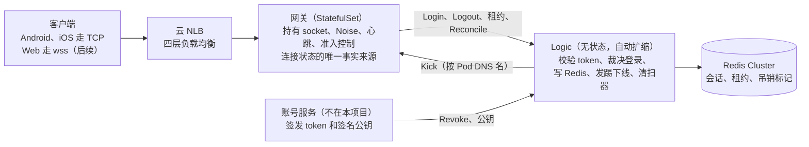

# 连接与会话核心 —— 阅读指南（对应 spec rev4）

*截至 2026-10-04。本文是 [rev4 设计文档](../superpowers/specs/2026-10-03-connection-session-core-design-rev4.md) 的通俗版导读；两者不一致时，以设计文档为准。English version: [connection-session-core-guide.md](connection-session-core-guide.md)。*

## 这是什么

子项目 1 负责记录**谁在线、连在哪台服务器上**，服务对象是一个约 100 万同时在线用户的类微信 IM。范围包括：建连、加密握手、登录、心跳、踢下线、吊销和断开。消息、推送和朋友圈放在后续子项目。

**三个目标**

| 目标 | 指标 |
| --- | --- |
| 容量 | 单台网关能承载 60 万连接（压测基准）。生产环境每台不超过 20 万，这样坏一台影响更小。 |
| 恢复 | 一台网关宕机后，它上面 99% 的用户在 30 秒内重新登录成功。 |
| 正确性 | 迟到或乱序的事件永远不会踢掉或删除一个更新的会话。我们已知的每一种竞态都有自动化测试覆盖。 |

100 万用户至少部署 6 台网关：5 台承载流量，1 台冗余，因此任意一台都可以挂掉。

## 整体架构

服务端有三种角色，外加一条硬规则：**网关从不访问 Redis，只有 Logic 访问。**

| 组件 | 职责 | 是否有状态 |
| --- | --- | --- |
| 客户端（Android、iOS；Web 后续） | 维持一条长连接加密通道；按固定规则重连 | 自己的 device_id 和一个连接计数器 |
| 云 NLB（四层） | 把 TCP 连接分散到各台网关 | 无 |
| 网关（Kubernetes StatefulSet，每个 Pod 一个 Go 进程，基于 gnet） | 持有 socket；负责加密、分帧、心跳和准入控制 | **有：在线连接本身。它是"谁连着"的唯一事实来源。** |
| Logic（无状态 Deployment，自动扩缩） | 校验 token、裁决谁赢得登录、写 Redis、发送踢下线 | 无 |
| Redis Cluster | 存储"用户 X 在网关 G 的连接 C 上在线" | 一份副本，由 Logic 负责与网关保持一致 |
| 账号服务（不在本项目范围内） | 签发登录 token；请求 Logic 吊销会话 | 不归我们管 |

网关和 Logic 之间双向使用 gRPC。网关向 Logic 发送登录、登出、租约续期和对账报告；Logic 按 DNS 名直接把踢下线请求发给指定的网关 Pod。

## 先认识六个词

后面的设计都建立在这几个概念上。

| 术语 | 含义 | 例子 |
| --- | --- | --- |
| **Slot（槽位）** | 每个"用户 + 应用 + 平台类型"只允许一个会话。同一槽位上的新登录会替换旧的。 | Alice 的手机和 Alice 的 PC 是两个槽位，可以同时在线；Alice 的两部手机共用一个槽位，第二部会把第一部踢下线。 |
| **Epoch（纪元）** | 网关每次启动时随机生成的一个数，用来区分同一个 Pod 的两次"生命"。 | `gw-17` 崩溃重启后，新旧进程的 epoch 不同，旧进程留下的数据不会和新进程混淆。 |
| **conn_id** | 连接 ID，在一个 epoch 内唯一且永不复用。 | 针对连接 42 的登出，只可能删除连接 42 的记录。 |
| **device_id + conn_seq** | 一次 App 安装的身份标识，加上每次建连都会递增的计数器。 | 手机重连时先发 conn_seq 7、再发 8，于是更新的连接胜出。 |
| **Lease（租约）** | 每台网关每 10 秒续期一次的 Redis key，30 秒后过期。 | 租约存在 = 网关存活。只有所属网关的租约存在时，会话记录才算有效。 |
| **Reconcile（对账）** | 周期性检查（约每 10 分钟）：网关把自己实际持有的连接列表发给 Logic，Logic 据此修正 Redis。 | 某次登出丢失，留下一条过期的"在线"记录；下一次对账会把它删掉。 |

在 Redis 中，会话存储为 `sess:{uid}` → 每个槽位一个字段，值为 `gateway | epoch | conn_id | device_id | conn_seq | 登录时间 | token 签发时间`。

## 一条连接的一生

连接会经历四个状态：**HANDSHAKE → AUTH_PENDING → ONLINE → CLOSED**。

1. **建连。** 手机向 NLB 发起 TCP 连接，NLB 选一台网关。如果该网关已满（25 万 socket），会立刻关闭连接，手机在 1–3 秒后重试，大概率会落到另一台网关。
2. **握手（HANDSHAKE，限时 5 秒）。** 手机与网关执行 Noise NK 握手。服务端公钥内置在 App 里，不涉及证书。此后每一帧都用 ChaCha20-Poly1305 加密。
3. **登录（AUTH_PENDING，需在 5 秒内发出）。** 手机发送 token、应用、平台、device_id 和 conn_seq。网关记录到达时间（`recv_ms`），并批量转发给 Logic。
4. **Logic 裁决。** 在本地校验 token 签名（不查数据库），然后执行一个原子的 Redis 脚本，要么写入会话，要么拒绝（见下一节）。如果某个旧连接因此失去槽位，Logic 会向它所在的网关发送 **Kick**。
5. **在线（ONLINE）。** 服务端告诉手机每 150 秒发一次 ping，收到任何帧都算存活。静默 310 秒后，网关判定连接已死。
6. **关闭（CLOSED）。** 网关向 Logic 发送 **Logout**；只有当 Redis 记录仍指向这条连接时，Logic 才会删除它。

**用户可能看到的踢下线原因。** 任何一种都不会让 App 自动重连，以防两台设备无限互踢。

| 原因 | 场景 | App 行为 |
| --- | --- | --- |
| `REPLACED` | 同一设备有了更新的连接 | 静默；等用户回到 App 时再重连 |
| `KICKED_BY_OTHER_DEVICE` | 另一台设备占用了该槽位 | 提示用户 |
| `REVOKED` | 封号、改密码、"退出所有设备" | 丢弃 token，回到登录页 |

**登录 token** 有效期很短（约 1 小时），且只在登录时校验。已在线的连接不会因为 token 过期而被断开；长连接的安全靠吊销机制保障。

## 在竞态下保持正确

经典 bug：用户的旧连接断了，他在别处重连成功，结果旧连接*迟到*的断开事件把*新*会话删掉了。下面四个简单手段可以防住这类问题，不需要分布式锁。

**1. 只删属于自己的记录。** 只有当 Redis 记录仍是*本*连接的 `gateway | epoch | conn_id` 时，Logout 才会删除它。由于 conn_id 永不复用，旧连接迟到的 Logout 只会看到别人的记录，什么也不做。

**2. 每次登录由一个原子脚本裁决。** 同一用户的所有数据都在同一个 Redis slot 中，所以一个 Lua 脚本就能原子地读写。脚本把新登录与已存会话比较：

| 已存会话 vs 新登录 | 结果 |
| --- | --- |
| 没有已存会话 | 写入 |
| 同一手机，conn_seq 更大 | 新的胜出，踢掉旧的（`REPLACED`） |
| 同一手机，conn_seq 相同或更小，5 秒以内 | 以 `STALE` 拒绝：这是一次迟到的旧尝试。回复中带上已存的计数器值，方便手机追上。 |
| 同一手机，conn_seq 更小，超过 5 秒 | 接受：计数器回退了（重装 App、恢复备份） |
| 不同手机，到达更晚 | 新的胜出，踢掉旧的（`KICKED_BY_OTHER_DEVICE`） |
| 不同手机，到达更早 | 以 `SUPERSEDED` 拒绝：更新的设备已经赢了 |

**3. 5 秒登录截止时间。** 如果一次登录在网关收到后超过 5 秒（`login_deadline`）才到达 Redis，脚本会拒绝它（`EXPIRED`）。因此过了 `recv_ms + 5s` 之后，可以确定这次登录再也写不进任何东西，即使它的回复丢了。

**4. Logout 栅栏。** 网关会暂缓发送某条连接的 Logout，直到这条连接不再有任何更早的写入可能落地：

- 它的 Login 已有明确结果，**或者**网关收到登录后已过去 6 秒（截止时间 + 1 秒时钟偏差）；**并且**
- 没有任何包含该连接的对账报告还在等待回复（同样适用 6 秒规则）。

这几条合起来保证：Logout 总是在所有可能与它竞争的写入*之后*落地，因此绝不会被迟到的写入覆盖。

**例子。** 手机用连接 A 进了隧道，出来后在另一台网关上以连接 B 重连。B 登录成功，Redis 里记的是"B"。几分钟后，A 所在的网关发现 A 静默，发送 Logout(A)。Redis 里是"B"不是"A"，于是什么都不删。

## 网关宕机时

宕机网关的会话在 30 秒内失效，随后很快被删除；健康网关的会话绝不会被误删。

**第 1 步：会话失效（≤ 30 秒）。** 会话只有在所属网关的租约存在时才有效。宕机网关不再续期，租约过期，它的所有会话瞬间同时失效——这发生在删除任何数据之前。它的用户此时已经开始在别处重连。

**第 2 步：清扫器清理（约 60 秒后）。** 每个 Logic 节点都运行一个清扫器。它查找 60 秒（租约 TTL 的两倍）未续期、或已声明正常下线的 epoch，先抢占认领（避免多个节点同时处理），然后以约每秒 1 万用户的速度删除该 epoch 的会话记录。

**第 3 步：安全闸。** 如果 Redis 或 Logic 出了一分钟的故障，*所有*网关都会停止续期，一个简单的清扫器就会把所有人都删掉。因此清扫器只在以下条件同时满足时才清扫：

- 有**其他**网关在最近 15 秒内续期过，并且这一状态已持续满 30 秒；**并且**
- 清扫器自身访问 Redis 已连续健康 30 秒。

"没有任何网关在续期"说明问题出在我们自己这边，而不是网关，所以安全闸会等待。续期恢复后再等 30 秒，让每台健康网关都有三次续期机会。等待永远不会影响正确性，因为宕机网关的记录在第 1 步就已经失效了。

**第 4 步：撤销误清扫。** 如果健康网关还是被误清扫了（比如只有它的续期被阻断），它下一次续期会发现租约 key 不存在，回复为 `missing`。网关随即高速重新上报所有连接（20 万约 40 秒），Logic 把它们写回。如果网关在清扫过程中续期成功，清扫器会注意到这次新的续期并立即停止。

**正常下线（发布部署）。** 收到 SIGTERM 后，网关停止接受新连接，在约 60 秒内分批通知客户端重连（带随机延迟），然后声明 `EpochEnded`，以便立即被清扫。

## 让 Redis 保持真实：Reconcile（对账）

消息总会丢：Logout 丢了、Kick 没送到、Redis 主从切换丢了一秒的写入。我们不去追求每条消息都绝对可靠，而是让每台网关定期告诉 Logic 真实情况，由 Logic 修正 Redis。任何不一致都会在一个周期内（约 10 分钟）修复。

**一轮对账分两部分。**

1. **分块上报。** 网关把在线连接分成小批、限速发送（平时约每秒 330 条，收到 `missing` 租约回复后约每秒 5000 条）。对每一条，Logic 执行以下之一：
    - token 在登录后已被吊销 → 通知网关关闭该连接（`REVOKED`）；
    - Redis 已一致 → 仅刷新记录过期时间；
    - Redis 为空，或指向已死的网关 → 把这条写回去；
    - Redis 指向另一个*仍存活*的会话 → 用与登录相同的规则判断谁更新（平局时已存的胜出）。如果网关上报的更新（只可能发生在写入丢失之后），就写回并踢掉另一个；否则通知网关关闭自己的连接。
2. **ReconcileEnd。** 所有分块都得到回复后，网关发送它仍在跟踪的全部连接 ID 列表，并附上时间（`as_of_ms`）。Logic 删除该网关名下所有**不在**列表中、且登录时间**早于** `as_of_ms` 的记录，从而清除因 Logout 丢失而残留的"幽灵"会话。

**为什么这样是安全的。**

- 一条连接在其 Logout 栅栏放行之前，始终留在网关的跟踪列表中，因此登录尚在途中的连接绝不会被删。
- 每次写入都是 compare-and-set：如果 Redis 期间被改过，或这批数据已超过 5 秒，就放弃。因超时被拒的批次会在同一轮内重发，最多 3 次。
- 每台网关同一时间只运行一轮对账。如果普通对账进行中收到 `missing` 租约回复，该轮会被取消（不发送 ReconcileEnd），并立即开始一轮快速对账。

**开销。** 平时每台网关约每秒 330 次 Redis 脚本调用，6 台合计约每秒 2000 次。

## 扛住重连风暴

一台承载 20 万用户的网关宕机时，这 20 万部手机会同时重连。分散在 0–20 秒的随机延迟里，约为每秒 1 万次登录，是系统设计容量（每秒 2 万）的一半。

**客户端怎么做**

| 情况 | 重试前等待 |
| --- | --- |
| 已建立的连接意外断开 | 随机 0–20 秒，之后指数退避，上限 5 分钟 |
| 握手完成前服务端关闭了 socket（网关已满或过载） | 1–3 秒，最多连续 5 次，之后指数退避 |
| 服务端回复 `Busy{retry_after}` | 按服务端给的时间（1–3 秒） |
| 发出 Ping 后 10 秒内无任何回复 | 判定服务端已死，重连 |
| 被踢下线（任何原因） | 不自动重连 |

每次重试都使用新的源端口，因此 NLB 大概率会选到另一台网关。

**网关怎么做（准入控制）**

- **连接上限 25 万 socket。** 超过上限时，新 socket 在做任何加密运算之前就被关闭，使负载在各网关之间保持均衡。
- **握手限流。** 对进行中的握手数量和每秒握手次数做全网关级限制，防止握手洪峰拖垮已有连接。绝不按 IP 限流，因为大量移动用户通过运营商 NAT 共用一个 IP。
- **登录队列上限。** 如果 Logic 变慢、排队的登录过多，就回复 `Busy`（1–3 秒）。
- **超时。** 握手须在 5 秒内完成，登录须在 5 秒内发出，避免慢速或空闲 socket 长期占位。

**Logic 怎么做。** Logic 无状态，常驻副本数足以*不依赖*自动扩容就扛住每秒 2 万的峰值。它在本地校验 token；租约续期使用独立的连接和工作池，登录风暴不会阻塞续期。

**不在 SLO 范围内。** 同时失去多台网关（整个可用区）属于尽力而为：幸存网关填满到上限，其余客户端持续重试，直到 Kubernetes 重新调度出丢失的 Pod。

## 后续子项目可以依赖什么

Redis 中的在线状态是*最终*正确的，下表给出了偏差的上界。消息（子项目 2）和推送（子项目 3）应按这些数值设计缓存和兜底逻辑。

| 可能看到的情况 | 原因 | 最长持续时间 |
| --- | --- | --- |
| 显示在线，但连接已不存在 | Logout 丢失 | 一个对账周期（约 10 分钟） |
| 被替换或吊销后，旧设备仍连着 | Kick 丢失 | 一个周期 |
| 宕机网关的记录仍留在 Redis | 网关宕机 | 30 秒后失效；约 60–90 秒加清扫耗时后删除 |
| 在线用户在 Redis 中缺失 | Redis 主从切换丢了写入，或被误清扫 | 一个周期；误清扫后约 1 分钟 |
| 健康用户被判为离线 | Logic 或租约所在的 Redis 分片故障超过 30 秒 | 与故障持续时间相同 |

**对后续子项目的约束**

- 一条连接只有在 Redis 显示它拥有自己的槽位时，才能以该用户身份行事（发消息等）。子项目 2 必须强制执行这一点；使用缓存检查即可。
- 不要通过逐条读取会话及其租约来判断有效性。高效的读取路径由子项目 2/3 负责设计。
- 不要仅因为会话判为无效就触发大规模离线推送。上表最后一行说明，故障期间所有人都可能看起来离线。

## 尚未决定的问题与延伸阅读

还有一个真正的缺口尚未决定，另有四个 rev4 中的小决定等待确认。

- **单槽位吊销（未决定）。** "让这台设备下线"会删除会话，但不留下标记。如果 Kick 丢失，下一次对账可能把会话又写回去。引入按槽位的吊销标记可以补上这个缺口。
- **待确认的 rev4 小决定：** ReconcileEnd 失败后最多重试 60 秒；忽略网关首次租约续期时的 `missing`；中止的清扫器释放其认领；新增第四种对账结果 `unchanged`，表示因并发修改而未写入。

**有意不做的：** 按用户的登录限流、按 IP 限流、分布式锁和反向索引。它们要么在风暴中误伤正常用户，要么在有了单用户原子脚本之后已无必要。

**延伸阅读**

- 完整设计文档：`docs/superpowers/specs/2026-10-03-connection-session-core-design-rev4.md`，包含完整的竞态清单（16 种）、故障表、监控指标和测试计划。
- 每条规则的来由：`docs/superpowers/objections/` 中的评审决议（共三轮）。
